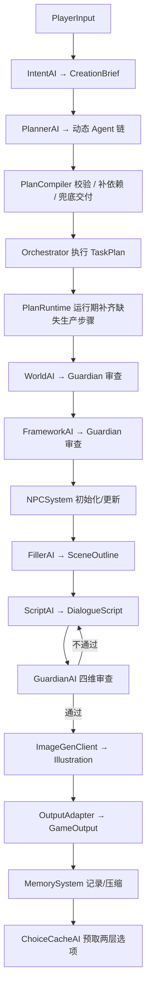

# MADNE - Multi-Agent Dynamic Narrative Engine

基于规格文稿构建的**初步框架**：输入玩家的一句话需求，由多个专业化 LLM Agent 协作，最终输出游戏引擎可消费的结构化叙事 JSON。

当前版本优先打通「数据契约 → 工作流 → Mock 全流程 → 审查回灌 → 持久化」，真实 LLM 与高级能力均保留清晰扩展点。

## 快速开始

```powershell
# 安装（开发模式）
python -m pip install -e ".[dev]"

# Mock 跑通完整流程（单回合）
python -m madne run --input "我想要一个赛博朋克世界里，关于记忆买卖的侦探故事"

# 连续 3 回合，并每 2 个记忆事件压缩一次，便于观察记忆回路
python -m madne run --input "我想要一个赛博朋克世界里，关于记忆买卖的侦探故事" `
  --turns 3 --compress-every 2 --print-json

# 断点续跑（模拟中断后恢复最近一次 ContextStore）
python -m madne resume --session demo

# 测试
python -m pytest
```

> 已 `pip install -e .` 后也可直接使用 `madne run ...`。

> **分发给测试者**：只需发送 `dist\MADNE.exe`。测试者默认进入**玩家界面**；
> 首次启动会自动弹出「API 配置」窗口，输入自己的 Key 即可。
> Key 保存在本机用户目录，不会进入 exe、RunLog 或分发包。

## 接入 DeepSeek

`madne.config` 会自动加载项目根目录或当前工作目录的 `.env`（已被 `.gitignore` 排除），真实环境变量优先。

复制 `.env.example` 为 `.env`，填入 Key：

```dotenv
LLM_API_KEY=sk-your-deepseek-key
LLM_BASE_URL=https://api.deepseek.com/v1
LLM_MODEL=deepseek-chat
LLM_MAX_TOKENS=8192
MADNE_MOCK=0
MADNE_PREFETCH_CHOICES=1

# 场景插图：diffusers（本地 SD，默认）/ mock / ark / comfyui
IMG_ENABLED=1
IMG_BACKEND=diffusers
IMG_TIMEOUT=60
IMG_WIDTH=1024
IMG_HEIGHT=768
IMG_CONSISTENCY_MODE=self_attn
```

然后直接运行（无需额外参数，CLI 会遵循 `.env`）：

```powershell
python -m madne run -i "我想要一个赛博朋克世界里，关于记忆买卖的侦探故事"
# 或显式指定真实模型
python -m madne run --real -i "我想要一个赛博朋克世界里，关于记忆买卖的侦探故事"
```

- `LLMClient.complete(prompt, system, json_schema)` 是唯一 LLM 入口。
- `MockLLMClient` 按系统提示词中的 `# AGENT_ID` 返回预设 JSON。
- `OpenAICompatClient` 通过标准 Chat Completions 接口调用，无第三方 HTTP 依赖；DeepSeek 只需配置兼容 Base URL 与 `deepseek-chat`。
- 未设置 `MADNE_MOCK` 且没有 API Key 时自动回退 Mock，保证 Demo 可运行。

以上 `.env` 方式主要面向 **CLI 与开发**。打包后的 `MADNE.exe` 不读取 `.env`，
也不读取构建机的 `%APPDATA%` 配置；它只使用 exe 同目录的便携配置
`config/config.json`。每位使用者在「API 配置」窗口输入自己的 Key，
分发时不要附带 `.env` 或 `config` 目录。

## 场景插图（多模态）

每个回合在文本生成完成后，会按 `IMG_BACKEND` 生成一张场景插图，写入
`<data_dir>/sessions/<session>/assets/cycle_XXX.png`，并作为可选字段
`illustration` 附加到 `GameOutput`：

- `relative_path`：相对数据目录的落盘路径，桌面端直接读取；
- `url`：`/assets/{session}/{filename}`，供 REST / 游戏引擎静态资源路由使用；
- `characters`：本场涉及角色的稳定外观描述；
- `consistency_mode`、`seed`、`reference_images`、`metrics` 等。

可用后端（`IMG_BACKEND`）：

| 值 | 依赖 | 说明 |
|---|---|---|
| `diffusers`（默认） | 本地 GPU + torch/diffusers | 默认 `sd-turbo` 本地生成；单张默认限时 60 秒 |
| `mock` | 无 | 纯标准库生成占位 PNG，CI / 无 GPU 时自动降级使用 |
| `comfyui` | 部署方的 ComfyUI 实例 | 通过 `COMFYUI_URL` 提交工作流；自定义 InstantID 工作流可使用 `{{REFERENCE_IMAGE}}` 占位符 |
| `ark` | 火山方舟 / 豆包 Seedream API | `doubao-seedream-4-0-250828`；也兼容 `seedream` / `hunyuan` 别名 |

**本地 SD 是默认路径**；在线 API 需要在「API 配置」窗口中选择“在线 API（可选）”
才会启用。即使本机保存过生图 API Key，只要生图方式仍是“本地 SD”，API 就不会
被自动使用。

每个回合（也就是每次显示新行动选项的界面）都会根据当前 `SceneOutline` 的
场景、动作和 `involved_npcs` 的外观生成一张插图；插图会出现在玩家界面
故事正文上方，并写入 `GameOutput.illustration`。

### 本地 SD 生成（默认路径）

```powershell
# 安装本地 SD 依赖（CPU 版）
python -m pip install -e ".[image]"

# NVIDIA GPU 建议先按 https://pytorch.org/get-started/locally/
# 选择对应 CUDA 版本的 torch 安装命令，再执行上面的命令
```

```dotenv
IMG_ENABLED=1
IMG_BACKEND=diffusers
IMG_TIMEOUT=60                 # 单张生成上限（秒）
MODEL_CACHE_DIR=./models       # 首次运行会下载权重到这里
IMG_MODEL=stabilityai/sd-turbo   # 轻量快速模型（约 2.5GB）
IMG_WIDTH=512
IMG_HEIGHT=512
IMG_STEPS=4
IMG_GUIDANCE=0
IMG_ALLOW_CPU=0                # 无 GPU 时可设为 1，但会远超 1 分钟
# 已有单文件权重（.safetensors / .ckpt）时直接加载，跳过下载：
# IMG_MODEL_PATH=./sd_turbo.safetensors
# 也可以不配置：会自动在 MODEL_CACHE_DIR、其父目录（exe/项目根目录）
# 与当前目录查找与模型同名的文件（如 sd-turbo → sd_turbo.safetensors）。
# 国内网络：不配置也会在官方站点失败后自动回退 hf-mirror.com
# 配置后只使用指定镜像
# MADNE_HF_ENDPOINT=https://hf-mirror.com
# 镜像可能把权重重定向到 Xet CAS，慢速链路易读超时；
# 下载器默认已把读超时放宽到 120 秒，可按需覆盖
# HF_HUB_DOWNLOAD_TIMEOUT=120

# 可选：显存充足时改用 SDXL 提升画质（约 7GB）
# IMG_MODEL=stabilityai/stable-diffusion-xl-base-1.0
# IMG_WIDTH=1024
# IMG_HEIGHT=768
# IMG_STEPS=28
# IMG_GUIDANCE=5
```

`diffusers` 后端会自动识别 SD 1.5 / SD 2.1 / SDXL 管线。默认的
`sd-turbo` 只需 4 步，适合 8GB 显存并稳定控制在 60 秒内；需要更高画质时
再切换到 SDXL。

- 模型权重只加载一次；**首次下载/加载时间不计入 `IMG_TIMEOUT`**。
- 超时时间可在「API 配置」窗口的“单张时间上限”中修改（10–600 秒，默认 60）；
  CLI 使用 `IMG_TIMEOUT`。
- 本地 SD 会按采样步数推送进度：玩家界面显示“正在生成本回合插图：2/4（50%）”，
  运行日志同步记录。
- 超过时限会立即中止采样，**本回合不生成插图**并在界面提示；不会用 Mock
  占位图代替。其他非超时失败仍会降级 Mock。
- 在较慢的 GPU 上建议降低 `IMG_STEPS`（例如 16–20）或分辨率，以保证
  每张在 1 分钟内完成。
- `IMG_ALLOW_CPU=0` 时如果没有可用 GPU，会直接降级 Mock；设 `1` 后
  CPU 推理可能远超过 60 秒。

#### 权重下载慢 / 下载失败

下载逻辑已针对国内网络做了三点优化：

1. **只拉必要文件**：仓库里的 fp32 / `.bin` / `.onnx` 等副本会被跳过，
   每个组件优先取 `*.fp16.safetensors`，sd-turbo 实际下载量约 2.4GB；
2. **自动镜像回退**：直连 `huggingface.co` 超时或失败后自动改用
   `hf-mirror.com`；镜像会把权重重定向到 Xet CAS，下载器已把读超时
   从默认 10 秒放宽到 120 秒，避免慢速链路上反复中断；
3. **断点续传 + 落盘进度**：中断后重跑会跳过已完成文件，日志显示
   `正在下载模型权重：45%（1.02 GB / 2.26 GB）`（按实际落盘字节统计，
   不会因重试而虚高）；超过 15 分钟的孤儿临时分片会自动清理。

手动预下载（推荐在第一次生图前执行）：

```powershell
madne models status              # 查看是否已缓存（不联网）
madne models download            # 下载 IMG_MODEL 到 MODEL_CACHE_DIR
madne models download --mirror   # 强制走 hf-mirror.com
madne models download --model stabilityai/sdxl-turbo
```

> 需要登录/接受许可的仓库（如 SDXL 官方 base）请先在 Hugging Face 页面
> 同意条款，并设置 `HF_TOKEN`；否则会返回 401/403。

如果本地已有单文件权重（例如把 `sd_turbo.safetensors` 放在项目根目录），
下载器会**直接使用该文件**，不会再次联网：

- 显式指定：`IMG_MODEL_PATH=./sd_turbo.safetensors`；
- 不配置也会自动查找：`MODEL_CACHE_DIR`、其父目录（exe/项目根目录）、
  当前目录下与模型同名的 `.safetensors` / `.ckpt`
  （`stabilityai/sd-turbo` → `sd_turbo.safetensors` 或 `sd-turbo.safetensors`）。
- 单文件通过 `from_single_file` 加载；若已有 diffusers 缓存，会复用其中的
  组件配置以完全离线。`madne health` 的 `model_file` 字段会显示当前使用的
  本地权重路径。

> 安装包体积主要来自 `torch`/CUDA 运行库，**SD 权重默认不打包进 exe**。
> 权重会在首次生图时下载到 `MODEL_CACHE_DIR`（桌面版为 exe 同目录 `models`）。
> `python -m madne health` 会显示 `model_cached`、`cache_dir` 与当前
> `hf_endpoint`；未缓存时可用 `madne models download` 提前下载。

### 可选：Seedream / OpenAI 兼容图像接口

桌面版的推荐配置方式：

1. 打开「API 配置」窗口；
2. 将“生图方式”切换为“在线 API（可选）”，再填写生图 API Key；
3. **Base URL 必须填服务商控制台提供的 OpenAI 兼容地址**，不能填混元默认
   地址（`https://api.hunyuan.cloud.tencent.com/v1` 不提供 Seedream 图像接口，
   会返回 404）。例如火山方舟为
   `https://ark.cn-beijing.volces.com/api/v3`；腾讯云或其他网关请填控制台
   里的实际地址。模型名填 API 文档中的模型 ID，不一定是控制台显示名；
4. 分辨率可填 `1280×720` 或 `1920×1080`；如果 Seedream 要求尺寸档位，
   可在“尺寸档位（可选）”填 `2K` / `4K`，留空则使用宽×高；
5. 保存前点击“测试生图”，窗口会显示实际请求地址和错误；成功后再保存。
   后续每个回合都会尝试调用生图 API；失败会自动回退 Mock 占位图，
   并在玩家界面提示“AI 生图失败”，不会中断文本生成。

### 生图失败排查

- **HTTP 401**：Key 不属于当前 Base URL，或 Key 已失效；请回到服务商控制台
  确认 Key 与接口地址是否配套。
- **HTTP 404**：Base URL 或接口路径错误。最常见的原因是 Seedream 模型仍在使用
  混元默认地址；请替换为服务商提供的 OpenAI 兼容地址。
- 在“API 配置”窗口点击“测试生图”，会显示 **实际请求 URL** 与错误详情；
  测试图保存到 `config\test_image.png`（源码版为 `%APPDATA%\MADNE\test_image.png`）。
- 玩家界面出现“AI 生图失败，已显示占位图”时，说明真实 API 调用失败，
  当前显示的是 Mock 占位图，不是模型生成的图片。
- 腾讯云 CloudBase AI 的 Base URL 通常形如
  `https://<环境ID>.api.tcloudbasegateway.com/v1`（环境 ID 在 CloudBase
  控制台）；火山方舟 Seedream 的 Base URL 为
  `https://ark.cn-beijing.volces.com/api/v3`，模型填控制台的模型 ID 或
  推理接入点 ID。
- 如果服务商使用腾讯云 `SecretId/SecretKey` 签名接口或自有 JSON 协议，
  当前 OpenAI 兼容客户端不适用；把官方 curl 示例发给开发方即可继续适配。

源码 / CLI 也可以用环境变量：

```dotenv
# 火山方舟 / 豆包 Seedream 4.0
IMG_BACKEND=ark
IMG_API_KEY=ark-your-key                  # 也可以使用 ARK_API_KEY
IMG_BASE_URL=https://ark.cn-beijing.volces.com/api/v3
IMG_API_MODEL=doubao-seedream-4-0-250828
IMG_API_SIZE=2K
# 方舟专用参数（与官方 REST 示例一致）
IMG_API_WATERMARK=1
IMG_API_SEQUENTIAL=disabled
IMG_API_STREAM=0

# 其他 OpenAI 兼容图像网关
# IMG_BACKEND=seedream
# IMG_BASE_URL=https://your-gateway/v1
# IMG_API_MODEL=your-image-model
```

`IMG_BACKEND=ark` 时客户端会发送：`model`、`prompt`、`size`、
`response_format="url"`、`sequential_image_generation`、`stream`、
`watermark`，然后自动下载响应中的 URL 并保存为 PNG。也支持
`ARK_API_KEY` / `ARK_BASE_URL` / `ARK_IMAGE_MODEL` / `ARK_IMAGE_SIZE`
环境变量作为别名。不要将真实 Key 写入仓库或分发包。

> Seedream / 混元等接口的 Prompt 长度上限较严格，代码会自动使用精简提示词
> 并截断到 256 字符。若你的服务商使用腾讯云签名接口（SecretId/SecretKey），
> 需要通过 OpenAI 兼容网关转换后再接入。

仓库内置了一份可直接编辑的 API 格式工作流模板
`comfyui/sdxl_basic_workflow.json`，设置
`COMFYUI_WORKFLOW=./comfyui/sdxl_basic_workflow.json` 即可使用。
若要使用 InstantID，请在 ComfyUI 中导出 API 格式工作流，并保留
`{{PROMPT}}` / `{{NEGATIVE_PROMPT}}` / `{{SEED}}` / `{{WIDTH}}` /
`{{HEIGHT}}` / `{{STEPS}}` / `{{GUIDANCE}}` / `{{CHECKPOINT}}` /
`{{REFERENCE_IMAGE}}` 占位符。

人物一致性：

- `IMG_CONSISTENCY_MODE=self_attn`：固定 session seed + 稳定角色外观提示；
- `IMG_CONSISTENCY_MODE=id_injection`：在 NPC 档案中设置 `reference_image`
  （相对数据目录或绝对路径）后，用参考图注入身份。桌面 / CLI 会话的档案位于
  SQLite 的 `npcs` 表（`<data_dir>/madne.db`），例如：
  `"reference_image": "characters/npc_linmo.png"`；
- `IMG_METRICS=1` 时本地计算 CLIP-I / DINO（需 `open_clip` / DINOv2），
  结果写入 `illustration.metrics`，用于验收 CLIP-I ≥ 0.75、DINO ≥ 0.65。

桌面玩家界面会在故事正文上方展示本回合插图；管理员界面可在完整 JSON 中查看
`illustration` 元数据，RunLog 也会记录插图后端、尺寸与耗时。

非超时的生图失败都会自动降级为 mock 占位图，并在 `illustration.warnings` 与
RunLog 中记录原因；**超过单张时间上限时不会出图**，本回合直接跳过插图并提示。

```powershell
# 本地 GPU 后端依赖（可选）
python -m pip install -e ".[image]"

# 查看 LLM / 图像后端 / 存储健康状态
python -m madne health

# 为已有会话最近一回合重绘插图（不调用叙事 LLM）
python -m madne image --session demo

# 单次运行临时切换图像后端或关闭插图
python -m madne run --mock -i "..." --img-backend mock --illustrate
python -m madne run --mock -i "..." --no-illustrate
```

## Windows 桌面 EXE（推荐）

已提供桌面启动器与一键打包脚本，产物为 `dist\MADNE.exe`：

- **双击 `dist\MADNE.exe`** 打开图形界面，无需命令行。
- 默认进入**玩家界面**：只显示故事设定、故事正文与行动选项；
  隐藏运行日志、完整 JSON、预取缓存、会话 ID、分支 ID、风险提示等非游玩内容。
- 玩家在开始页输入故事设定，点击“开始故事”即可游玩；
  故事中可通过“新的故事”返回开始页。
- **独立「API 配置」窗口**：首次启动若本机没有 Key 会自动弹出；
  玩家开始页也有「API 设置」按钮，故事中可按 `F11`（或 `Ctrl+Shift+K`）打开。
  - 输入自己的 LLM API Key（默认掩码显示，可切换显示）；
  - 可修改 Base URL、模型名与最大 Token；
  - “生图 API”区域可填写 Seedream / OpenAI 兼容图像接口的 Key、
    Base URL、模型、分辨率和可选尺寸档位；
  - 窗口下方有**可选的管理员邀请码**：普通玩家留空；
    输入 `admin` 并保存后解锁管理员界面；
  - “测试连接”会用当前输入发一次极小 LLM 请求，成功后再保存；
  - Key 仅保存在 exe 同目录 `config\config.json`，不会写入 exe、日志或
    输出目录；打包版不会读取 `.env` 或构建机的 `%APPDATA%` 配置。
- 生成完成后，玩家界面在故事正文上方显示本回合插图，在下方显示行动选项；
  选项只显示行动描述，不显示分支 ID、风险等级或任何审查/运行元数据。

### 玩家界面 / 管理员界面

- **玩家界面**是默认界面，也是分发给测试者时看到的界面。
- 在「API 配置」中填写管理员邀请码 `admin` 并保存后，会自动进入**管理员界面**：
  即原有的完整界面，包含运行日志、完整 JSON、预取选项、LLM 模式、风险提示等。
- 管理员界面提供“玩家界面”按钮；解锁后也可随时按 `F12`（或 `Ctrl+Shift+A`）
  在玩家界面与管理员界面之间切换。
- 管理员解锁状态会随本机 API 配置保存；清除本机配置后会重新锁定。
- 玩家界面没有管理员入口；`F12` 在未解锁时不会生效。

管理员界面保留原有能力：

- 输入故事需求，选择 LLM 模式（`真实模型` / `Mock 演示`），点击“开始生成”。
- 选项按钮固定在场景文本上方；生成或预取期间会暂时禁用，完成后自动恢复可点击。
- “预取两层选项”默认开启；“预取选项”页可查看当前每个分支未来两层的行动选项。
- “运行日志”显示每个步骤的成功 / 审查驳回 / 重试 / 降级 / 预取状态；
  “完整 JSON”页可直接查看游戏引擎数据，选项后保留风险等级提示。
- 所有记忆、RunLog、NPC、选项缓存与输出默认写入 `dist\runtime\madne.db`；
  插图与导出的 `output.json` 仍保存在 `dist\runtime\sessions\<session>\`。

### 分发给测试者

1. 运行 `build_exe.ps1` 重新构建；
2. 把 `dist\MADNE.exe`（以及可选的 `dist\README.md`）发给测试者；
3. **不要附带 `.env` 或 `dist\config`**：exe 不读取 `.env`，也不会继承构建机的
   `%APPDATA%` 配置；`dist\config` 是本机用户保存 Key 的便携目录，只供自己使用；
4. 测试者首次运行会在「API 配置」窗口输入自己的 LLM Key 和生图 Key；
   Key 只保存在测试者电脑上的 `config\config.json`；
5. 普通测试者无需填写管理员邀请码，默认就是玩家界面。

如果测试者需要重置 Key，在玩家界面按 `F11` 打开「API 配置」→
“清除本机配置”即可；清除后界面自动切回 `Mock 演示`。

重新构建：

```powershell
powershell -NoProfile -ExecutionPolicy Bypass -File build_exe.ps1
```

也可以直接双击 `build_exe.bat`。脚本会：

1. 优先使用项目内 `.venv\Scripts\python.exe`（不存在则用 PATH 中的 `python`）；
2. 自动安装构建与运行依赖：`torch`（默认 CUDA 12.8 轮子）、
   `diffusers`、`transformers`、`accelerate`、`safetensors`、`huggingface_hub`、
   `pyinstaller`，并安装项目 `[image]` 依赖；
3. 用 PyInstaller 收集 `torch/diffusers/transformers/huggingface_hub` 等动态模块，
   保证打包后的 exe 仍可使用本地 SD 后端；
4. 构建、复制说明文档并运行 EXE 自检，自检完成后自动清理临时产物。

常用参数：

```powershell
# 依赖已安装好时跳过 pip
powershell -NoProfile -ExecutionPolicy Bypass -File build_exe.ps1 -SkipDeps

# 目录版：启动快，适合包含 torch/CUDA 的构建（产物 dist\MADNE\MADNE.exe）
powershell -NoProfile -ExecutionPolicy Bypass -File build_exe.ps1 -OneDir

# 只用 CPU 版 torch（体积更小，推理很慢）
powershell -NoProfile -ExecutionPolicy Bypass -File build_exe.ps1 -TorchIndex ""
```

> 包含 torch/CUDA 时 `--onefile` 会生成数 GB 的单文件 exe，每次启动都要解压，
> 实际分发建议使用 `-OneDir`；此时把整个 `dist\MADNE` 目录一起发给测试者。

> 桌面版使用本地单文件权重时，把 `sd_turbo.safetensors` 放在
> `MADNE.exe` 同目录（或同目录的 `models\` 下）即可；构建脚本不会复制
> 这个数 GB 的权重文件。

无界面自检：

```powershell
# Mock 全流程自检（不消耗 API）
dist\MADNE.exe --selftest

# 真实 DeepSeek 连通性自检（使用「API 配置」中保存的 Key，消耗一次极小请求）
dist\MADNE.exe --selftest-real
```

结果分别写入 `dist\selftest_result.txt` 与 `dist\selftest_real_result.txt`。

## 目录结构

```text
madne/
├── config.py                 # 环境变量配置
├── user_config.py            # 本机用户级 API 配置（GUI 分发用）
├── exceptions.py             # 统一异常
├── models/                   # M0.2 全系统数据契约（Pydantic v2）
│   ├── base.py
│   ├── input.py / brief.py / plan.py
│   ├── world.py / framework.py / scene.py / script.py
│   ├── npc.py / review.py / output.py / memory.py
│   ├── cache.py              # 两层选项预取模型
│   └── __init__.py           # 模型导出 + 持久化类型注册表
├── llm/                      # M0.1 LLM 抽象与实现
│   ├── base.py               # Protocol / JSON 提取 / AGENT_ID 解析
│   ├── mock.py               # 预设响应 + 脚本化响应队列
│   ├── fixtures.py           # 赛博朋克 Demo 全套 Mock 数据
│   └── openai_compat.py      # OpenAI 兼容客户端
├── agents/                   # M1/M2/M4-M8 Agent 模块
│   ├── base.py               # 统一 JSON 校验与纠错重试
│   ├── prompts.py            # 世界红线注入 / 审查反馈格式化
│   ├── intent.py / planner.py / world.py / framework.py
│   ├── npc.py                # 从 StoryFramework 抽取角色池
│   ├── cache.py              # 两层选项预取 AI
│   ├── filler.py / script.py / guardian.py
│   └── __init__.py
├── engine/                   # M3 规则驱动工作流引擎
│   ├── templates.py          # Agent 能力注册表 + 动态计划编译器
│   ├── plan_runtime.py       # 运行期依赖修复 / 步骤注入
│   ├── context_store.py      # 共享上下文快照
│   ├── choice_cache.py       # 两层选项缓存
│   ├── run_log.py            # 结构化运行日志
│   └── orchestrator.py       # 调度 / 审查点 / 回退 / 续跑 / 预取
├── storage/database.py       # SQLite 持久化（上下文/日志/记忆/NPC/缓存/输出）
├── npc/system.py             # M9 角色池 + 规则驱动的 traits 演变
├── memory/system.py          # M10 完整记忆 + 压缩记忆合并
├── image/                    # 图像生成子系统
│   ├── base.py               # ImageGenClient / 请求结果契约
│   ├── hunyuan.py            # Seedream / OpenAI 兼容图像 API
│   ├── mock.py               # 零依赖占位 PNG
│   ├── comfyui.py            # ComfyUI HTTP 后端
│   ├── diffusers.py          # 本地 SDXL + IP-Adapter
│   ├── prompts.py            # 场景/角色提示词构造
│   ├── consistency.py        # CLIP-I / DINO 指标
│   └── factory.py            # 后端选择 + 失败降级
├── output/adapter.py         # M11 GameOutput 打包与校验
├── cli.py                    # Typer 命令行入口
comfyui/
└── sdxl_basic_workflow.json  # ComfyUI API 格式工作流模板（含占位符）
launcher.py                   # Tkinter 桌面启动器（打包为 MADNE.exe）
build_exe.ps1 / build_exe.bat # 一键构建 Windows EXE
tests/
├── test_models.py
├── test_dynamic_plan.py
├── test_pipeline.py
├── test_engine_resilience.py
├── test_image.py
├── test_gui.py
└── test_user_config.py
```

## 一次生成循环



- 每个步骤的成功/失败/重试/降级都写入 SQLite 的 `run_log` 表（`madne.db`）。
- 每完成一步把 `ContextStore` 快照写入 `contexts` 表；`resume` 会跳过已完成步骤继续执行。
- Guardian 驳回时，`suggested_fix + issues` 回灌给生成模块重写，最多 2 次，仍失败则降级交付并告警。
- 世界红线会注入 Framework / Filler / Script / Guardian 的系统提示词。
- 续写时 Planner 复用已有 WorldBible / NPC 池，并按需要用 `npc_update` 更新角色状态。

### 动态链如何工作

PlannerAI 不再从写死的模板里二选一，而是输出一份「Agent 顺序建议」：

1. **编译期**：`templates.compile_plan` 校验 Agent 名称，按 `required_inputs`
   拓扑排序，自动补齐 `world → framework → npc → filler → script` 中缺失的步骤；
   超出 `MADNE_MAX_PLAN_STEPS` 时优先保留交付链路。
2. **运行期**：`PlanRuntime` 在执行每一步前检查必需输入；若上下文缺失，
   会插入生产该输入的步骤（或把计划中靠后的生产步骤前移），最多修复
   `MADNE_PLAN_REPAIR_LIMIT` 次/Agent。
3. **收尾期**：`_ensure_delivery` 检查交付所需键，必要时追加步骤，保证
   任何一次规划异常都不会阻断 `GameOutput` 产出。
4. **降级**：LLM 输出非法或关闭动态链时，自动回退到 `cold_start` /
   `continuation` 模板。

相关环境变量：

```dotenv
MADNE_DYNAMIC_CHAIN=1        # 0 = 强制使用静态模板
MADNE_MAX_PLAN_STEPS=8       # 单次规划的最大步骤数
MADNE_PLAN_REPAIR_LIMIT=1    # 每个 Agent 的运行期修复次数
MADNE_DB_PATH=               # 可选，自定义 SQLite 文件路径
```

## 两层选项预取

`MADNE_PREFETCH_CHOICES=1`（默认开启）时，每次生成结束会预取未来两层选项：

- **第一层**：当前每个分支的下一组行动选项（每分支至少 3 个）。
- **第二层**：每个下一层选项之后的行动选项（每个至少 3 个）。
- 下一回合直接使用第一层作为框架分支；再下一回合使用第二层派生的缓存，不必再次调用预取 AI。
- 第二层消费完后自动重新预取，形成“预取 → 消费第一层 → 派生第二层 → 消费 → 重新预取”的交替循环。

缓存写入 SQLite 的 `choice_cache` 表；
CLI 使用 `--prefetch/--no-prefetch`，桌面界面使用“预取两层选项”开关与“预取选项”页。

## 产物位置

状态统一存放在 SQLite 数据库 `runtime/madne.db`：

| 表 | 内容 |
|---|---|
| `sessions` | 会话元数据、当前回合、计划模式 |
| `contexts` / `plans` | 每回合可恢复上下文与动态计划链 |
| `run_log` | 全流程步骤日志（含动态链修复记录） |
| `memory_events` / `compressed_memory` | 完整记忆事件流与压缩记忆 |
| `npcs` | NPC 档案与 traits |
| `choice_cache` | 两层选项预取缓存 |
| `outputs` | 每回合 `GameOutput` |

媒体与导出文件仍保留在文件系统，便于 GUI / 游戏引擎直接读取：

```text
runtime/
├── madne.db                     # 所有可恢复状态（SQLite）
└── sessions/<session_id>/
    ├── assets/cycle_001.png     # 场景插图
    └── cycles/cycle_001/
        └── output.json          # 导出的引擎 JSON（数据库为唯一事实来源）
```

> 首次打开旧版本会话目录时会自动导入 `runlog.jsonl` / `npcs.json` /
> `memory/*` / `choice_cache.json` / `cycles/*`，无需手工迁移。

## 当前实现范围

已实现（可运行、可测试）：

- M0 数据模型、LLMClient 抽象、Mock / OpenAI 兼容双实现
- M1–M7 Agent 主链路与提示词骨架
- M3 Orchestrator：动态规划链、运行期依赖修复、审查点、回退、RunLog、ContextStore 断点续跑
- SQLite 统一持久化：会话/上下文/计划/日志/记忆/NPC/选项缓存/输出，兼容旧 JSON 数据自动迁移
- M8 GuardianAI：世界观、框架、场景/台本三处审查；四维场景审查汇总；重写闭环
- M9 NPCSystem：NPCAI 从 StoryFramework 抽取角色池并持久化，事件规则表驱动 traits 演变；Filler/Script 会校验角色 ID 与说话人是否在档案中
- M10 MemorySystem：完整记忆事件流、每 N 事件压缩、压缩结果合并去重（SQLite 存储）
- M11 OutputAdapter：GameOutput 打包与引擎字段校验
- 两层选项预取：ChoiceCacheAI + ChoiceCacheStore；下一轮使用第一层，再下一轮消费派生的第二层；CLI/GUI 可开关
- 独立 API 配置窗口：本机用户配置、掩码输入、连接测试、清除配置；分发 exe 无需附带 `.env`
- 续写提示词：强制 continuation、上一场戏衔接、选择后果、预取分支约束与 Beat 推进
- CLI Demo：多回合模拟玩家选择、记忆压缩频率可配、断点恢复、预取预览

后续扩展点（按规格继续迭代）：

- 并行执行无依赖步骤（World 与 NPC 池初始化等）
- NPC 复杂事件的 LLM 权重判定（当前为规则表 + 预留接口）
- SQLite 版完整记忆与更强的一致性事务
- 更丰富的多回合 Mock 场景（当前已提供第二场景；真实 LLM 会按 `previous_framework` 推进 Beat）
- 流式输出、Token 精确计量、Guardian 审查缓存

## 测试覆盖

`python -m pytest` 覆盖：

- 数据模型校验（traits 截断、分支数量、GameOutput 引擎字段）
- Mock 全流程产出合法 `GameOutput`（含 3 个选项）
- Guardian 驳回后回灌重写闭环；low/medium 建议不阻断交付
- NPC 角色抽取、未知 `npc_id` / speaker 自动重试
- NPC traits 规则演变
- 压缩记忆合并去重
- ChoiceCache 两层结构与父节点校验
- 两层缓存预取、第一层消费、第二层派生与关闭开关
- GUI 输出渲染后生成可点击的选项按钮
- API 配置读写往返与生效；管理员解锁状态持久化
- GUI「API 配置」窗口默认值与邀请码校验
- 玩家/管理员界面切换；玩家界面不显示分支 ID、风险提示与场景 ID
- ContextStore 模型往返持久化
- 多回合续写；第三回合框架体现压缩记忆中的盟友偏好
- 从部分完成的 ContextStore 断点恢复
