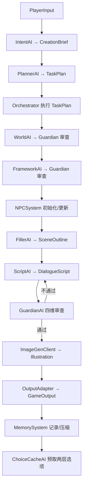

# MADNE - Multi-Agent Dynamic Narrative Engine

基于规格文稿构建的**初步框架**：输入玩家的一句话需求，由多个专业化 LLM Agent 协作，最终输出游戏引擎可消费的结构化叙事 JSON。

当前版本优先打通「数据契约 → 工作流 → Mock 全流程 → 审查回灌 → 持久化」，真实 LLM 与高级能力均保留清晰扩展点。

## 快速开始

```powershell
# 安装（开发模式）
python -m pip install -e ".[dev]"

# Mock 跑通完整流程（单回合）
python -m madne run --input "我想要一个赛博朋克世界里，关于记忆买卖的侦探故事"

# 连续 3 回合，并每 2 个记忆事件压缩一次，便于观察记忆回路
python -m madne run --input "我想要一个赛博朋克世界里，关于记忆买卖的侦探故事" `
  --turns 3 --compress-every 2 --print-json

# 断点续跑（模拟中断后恢复最近一次 ContextStore）
python -m madne resume --session demo

# 测试
python -m pytest
```

> 已 `pip install -e .` 后也可直接使用 `madne run ...`。

> **分发给测试者**：只需发送 `dist\MADNE.exe`。测试者默认进入**玩家界面**；
> 首次启动会自动弹出「API 配置」窗口，输入自己的 Key 即可。
> Key 保存在本机用户目录，不会进入 exe、RunLog 或分发包。

## 接入 DeepSeek

`madne.config` 会自动加载项目根目录或当前工作目录的 `.env`（已被 `.gitignore` 排除），真实环境变量优先。

复制 `.env.example` 为 `.env`，填入 Key：

```dotenv
LLM_API_KEY=sk-your-deepseek-key
LLM_BASE_URL=https://api.deepseek.com/v1
LLM_MODEL=deepseek-chat
LLM_MAX_TOKENS=8192
MADNE_MOCK=0
MADNE_PREFETCH_CHOICES=1

# 场景插图：三选一（mock / comfyui / diffusers），默认 mock
IMG_ENABLED=1
IMG_BACKEND=mock
IMG_WIDTH=1024
IMG_HEIGHT=768
IMG_CONSISTENCY_MODE=self_attn
```

然后直接运行（无需额外参数，CLI 会遵循 `.env`）：

```powershell
python -m madne run -i "我想要一个赛博朋克世界里，关于记忆买卖的侦探故事"
# 或显式指定真实模型
python -m madne run --real -i "我想要一个赛博朋克世界里，关于记忆买卖的侦探故事"
```

- `LLMClient.complete(prompt, system, json_schema)` 是唯一 LLM 入口。
- `MockLLMClient` 按系统提示词中的 `# AGENT_ID` 返回预设 JSON。
- `OpenAICompatClient` 通过标准 Chat Completions 接口调用，无第三方 HTTP 依赖；DeepSeek 只需配置兼容 Base URL 与 `deepseek-chat`。
- 未设置 `MADNE_MOCK` 且没有 API Key 时自动回退 Mock，保证 Demo 可运行。

以上 `.env` 方式主要面向 **CLI 与开发**。桌面 EXE 的 Key 由每位使用者在
「API 配置」窗口中自行输入，保存到 `%APPDATA%\MADNE\config.json`（无 APPDATA 时回退 `~/.madne/config.json`），因此分发时不需要附带任何 `.env`。

## 场景插图（多模态）

每个回合在文本生成完成后，会按 `IMG_BACKEND` 生成一张场景插图，写入
`<data_dir>/sessions/<session>/assets/cycle_XXX.png`，并作为可选字段
`illustration` 附加到 `GameOutput`：

- `relative_path`：相对数据目录的落盘路径，桌面端直接读取；
- `url`：`/assets/{session}/{filename}`，供 REST / 游戏引擎静态资源路由使用；
- `characters`：本场涉及角色的稳定外观描述；
- `consistency_mode`、`seed`、`reference_images`、`metrics` 等。

三种后端（`IMG_BACKEND`）：

| 值 | 依赖 | 说明 |
|---|---|---|
| `mock`（默认） | 无 | 纯标准库生成占位 PNG，CI / 无 GPU 可用 |
| `comfyui` | 部署方的 ComfyUI 实例 | 通过 `COMFYUI_URL` 提交工作流；自定义 InstantID 工作流可使用 `{{REFERENCE_IMAGE}}` 占位符 |
| `diffusers` | 本地 GPU + torch/diffusers | SDXL；`id_injection` 可用 `IMG_IP_ADAPTER_DIR` 注入角色定妆照 |

仓库内置了一份可直接编辑的 API 格式工作流模板
`comfyui/sdxl_basic_workflow.json`，设置
`COMFYUI_WORKFLOW=./comfyui/sdxl_basic_workflow.json` 即可使用。
若要使用 InstantID，请在 ComfyUI 中导出 API 格式工作流，并保留
`{{PROMPT}}` / `{{NEGATIVE_PROMPT}}` / `{{SEED}}` / `{{WIDTH}}` /
`{{HEIGHT}}` / `{{STEPS}}` / `{{GUIDANCE}}` / `{{CHECKPOINT}}` /
`{{REFERENCE_IMAGE}}` 占位符。

人物一致性：

- `IMG_CONSISTENCY_MODE=self_attn`：固定 session seed + 稳定角色外观提示；
- `IMG_CONSISTENCY_MODE=id_injection`：在 NPC 档案中设置 `reference_image`
  （相对数据目录或绝对路径）后，用参考图注入身份。桌面 / CLI 会话的档案位于
  `<data_dir>/sessions/<session>/npcs.json`，例如：
  `"reference_image": "characters/npc_linmo.png"`；
- `IMG_METRICS=1` 时本地计算 CLIP-I / DINO（需 `open_clip` / DINOv2），
  结果写入 `illustration.metrics`，用于验收 CLIP-I ≥ 0.75、DINO ≥ 0.65。

桌面玩家界面会在故事正文上方展示本回合插图；管理员界面可在完整 JSON 中查看
`illustration` 元数据，RunLog 也会记录插图后端、尺寸与耗时。

任意后端失败都会自动降级为 mock 占位图，并在 `illustration.warnings` 与
RunLog 中记录原因，文本回合不受影响。

```powershell
# 本地 GPU 后端依赖（可选）
python -m pip install -e ".[image]"

# 查看 LLM / 图像后端 / 存储健康状态
python -m madne health

# 为已有会话最近一回合重绘插图（不调用叙事 LLM）
python -m madne image --session demo

# 单次运行临时切换图像后端或关闭插图
python -m madne run --mock -i "..." --img-backend mock --illustrate
python -m madne run --mock -i "..." --no-illustrate
```

## Windows 桌面 EXE（推荐）

已提供桌面启动器与一键打包脚本，产物为 `dist\MADNE.exe`：

- **双击 `dist\MADNE.exe`** 打开图形界面，无需命令行。
- 默认进入**玩家界面**：只显示故事设定、故事正文与行动选项；
  隐藏运行日志、完整 JSON、预取缓存、会话 ID、分支 ID、风险提示等非游玩内容。
- 玩家在开始页输入故事设定，点击“开始故事”即可游玩；
  故事中可通过“新的故事”返回开始页。
- **独立「API 配置」窗口**：首次启动若本机没有 Key 会自动弹出；
  玩家开始页也有「API 设置」按钮，故事中可按 `F11`（或 `Ctrl+Shift+K`）打开。
  - 输入自己的 API Key（默认掩码显示，可切换显示）；
  - 可修改 Base URL、模型名与最大 Token；
  - 窗口下方有**可选的管理员邀请码**：普通玩家留空；
    输入 `admin` 并保存后解锁管理员界面；
  - “测试连接”会用当前输入发一次极小请求，成功后再保存；
  - Key 仅保存在本机 `%APPDATA%\MADNE\config.json`，不会写入 exe、日志或输出目录。
- 生成完成后，玩家界面在故事下方显示行动选项；选项只显示行动描述，
  不显示分支 ID、风险等级或任何审查/运行元数据。

### 玩家界面 / 管理员界面

- **玩家界面**是默认界面，也是分发给测试者时看到的界面。
- 在「API 配置」中填写管理员邀请码 `admin` 并保存后，会自动进入**管理员界面**：
  即原有的完整界面，包含运行日志、完整 JSON、预取选项、LLM 模式、风险提示等。
- 管理员界面提供“玩家界面”按钮；解锁后也可随时按 `F12`（或 `Ctrl+Shift+A`）
  在玩家界面与管理员界面之间切换。
- 管理员解锁状态会随本机 API 配置保存；清除本机配置后会重新锁定。
- 玩家界面没有管理员入口；`F12` 在未解锁时不会生效。

管理员界面保留原有能力：

- 输入故事需求，选择 LLM 模式（`真实模型` / `Mock 演示`），点击“开始生成”。
- 选项按钮固定在场景文本上方；生成或预取期间会暂时禁用，完成后自动恢复可点击。
- “预取两层选项”默认开启；“预取选项”页可查看当前每个分支未来两层的行动选项。
- “运行日志”显示每个步骤的成功 / 审查驳回 / 重试 / 降级 / 预取状态；
  “完整 JSON”页可直接查看游戏引擎数据，选项后保留风险等级提示。
- 所有记忆、RunLog、NPC 与 JSON 默认写入 `dist\runtime\sessions\<session>\`。

### 分发给测试者

1. 运行 `build_exe.ps1` 重新构建；
2. 把 `dist\MADNE.exe`（以及可选的 `dist\README.md`）发给测试者；
3. **不要附带 `.env`**：构建脚本已不再复制它，测试者在「API 配置」窗口输入自己的 Key；
4. 每位测试者的 Key 只存在自己的电脑上，互不影响，也不会打进 exe；
5. 普通测试者无需填写管理员邀请码，默认就是玩家界面。

如果测试者需要重置 Key，在玩家界面按 `F11` 打开「API 配置」→
“清除本机配置”即可；清除后界面自动切回 `Mock 演示`。

重新构建：

```powershell
powershell -NoProfile -ExecutionPolicy Bypass -File build_exe.ps1
```

也可以直接双击 `build_exe.bat`。脚本会构建、复制说明文档并运行 EXE 自检，
自检完成后自动清理分发包中的临时产物。

无界面自检：

```powershell
# Mock 全流程自检（不消耗 API）
dist\MADNE.exe --selftest

# 真实 DeepSeek 连通性自检（使用「API 配置」中保存的 Key，消耗一次极小请求）
dist\MADNE.exe --selftest-real
```

结果分别写入 `dist\selftest_result.txt` 与 `dist\selftest_real_result.txt`。

## 目录结构

```text
madne/
├── config.py                 # 环境变量配置
├── user_config.py            # 本机用户级 API 配置（GUI 分发用）
├── exceptions.py             # 统一异常
├── models/                   # M0.2 全系统数据契约（Pydantic v2）
│   ├── base.py
│   ├── input.py / brief.py / plan.py
│   ├── world.py / framework.py / scene.py / script.py
│   ├── npc.py / review.py / output.py / memory.py
│   ├── cache.py              # 两层选项预取模型
│   └── __init__.py           # 模型导出 + 持久化类型注册表
├── llm/                      # M0.1 LLM 抽象与实现
│   ├── base.py               # Protocol / JSON 提取 / AGENT_ID 解析
│   ├── mock.py               # 预设响应 + 脚本化响应队列
│   ├── fixtures.py           # 赛博朋克 Demo 全套 Mock 数据
│   └── openai_compat.py      # OpenAI 兼容客户端
├── agents/                   # M1/M2/M4-M8 Agent 模块
│   ├── base.py               # 统一 JSON 校验与纠错重试
│   ├── prompts.py            # 世界红线注入 / 审查反馈格式化
│   ├── intent.py / planner.py / world.py / framework.py
│   ├── npc.py                # 从 StoryFramework 抽取角色池
│   ├── cache.py              # 两层选项预取 AI
│   ├── filler.py / script.py / guardian.py
│   └── __init__.py
├── engine/                   # M3 规则驱动工作流引擎
│   ├── templates.py          # cold_start / continuation 静态模板
│   ├── context_store.py      # 共享上下文 + 断点持久化
│   ├── choice_cache.py       # 两层选项缓存持久化
│   ├── run_log.py            # JSONL 运行日志
│   └── orchestrator.py       # 调度 / 审查点 / 回退 / 续跑 / 预取
├── npc/system.py             # M9 角色池 + 规则驱动的 traits 演变
├── memory/system.py          # M10 完整记忆 + 压缩记忆合并
├── image/                    # 图像生成子系统
│   ├── base.py               # ImageGenClient / 请求结果契约
│   ├── mock.py               # 零依赖占位 PNG
│   ├── comfyui.py            # ComfyUI HTTP 后端
│   ├── diffusers.py          # 本地 SDXL + IP-Adapter
│   ├── prompts.py            # 场景/角色提示词构造
│   ├── consistency.py        # CLIP-I / DINO 指标
│   └── factory.py            # 后端选择 + 失败降级
├── output/adapter.py         # M11 GameOutput 打包与校验
├── cli.py                    # Typer 命令行入口
comfyui/
└── sdxl_basic_workflow.json  # ComfyUI API 格式工作流模板（含占位符）
launcher.py                   # Tkinter 桌面启动器（打包为 MADNE.exe）
build_exe.ps1 / build_exe.bat # 一键构建 Windows EXE
tests/
├── test_models.py
├── test_pipeline.py
├── test_engine_resilience.py
├── test_image.py
├── test_gui.py
└── test_user_config.py
```

## 一次生成循环



- 每个步骤的成功/失败/重试/降级都写入 `runtime/sessions/<id>/runlog.jsonl`。
- 每完成一步把 `ContextStore` 落盘；`resume` 会跳过已完成步骤继续执行。
- Guardian 驳回时，`suggested_fix + issues` 回灌给生成模块重写，最多 2 次，仍失败则降级交付并告警。
- 世界红线会注入 Framework / Filler / Script / Guardian 的系统提示词。
- 续写时 Planner 选择 `continuation` 模板，并继承上一轮 WorldBible、NPC 池与框架。

## 两层选项预取

`MADNE_PREFETCH_CHOICES=1`（默认开启）时，每次生成结束会预取未来两层选项：

- **第一层**：当前每个分支的下一组行动选项（每分支至少 3 个）。
- **第二层**：每个下一层选项之后的行动选项（每个至少 3 个）。
- 下一回合直接使用第一层作为框架分支；再下一回合使用第二层派生的缓存，不必再次调用预取 AI。
- 第二层消费完后自动重新预取，形成“预取 → 消费第一层 → 派生第二层 → 消费 → 重新预取”的交替循环。

缓存写入 `runtime/sessions/<session>/choice_cache.json`；
CLI 使用 `--prefetch/--no-prefetch`，桌面界面使用“预取两层选项”开关与“预取选项”页。

## 产物位置

```text
runtime/sessions/<session_id>/
├── runlog.jsonl                 # 全流程 RunLog
├── npcs.json                    # NPC 档案与 traits
├── memory/
│   ├── full.jsonl               # 完整记忆事件流
│   ├── compressed.json          # 压缩记忆
│   └── meta.json                # 压缩触发计数
└── cycles/cycle_001/
    ├── context.json             # 可恢复上下文
    └── output.json              # 游戏引擎 JSON
```

## 当前实现范围

已实现（可运行、可测试）：

- M0 数据模型、LLMClient 抽象、Mock / OpenAI 兼容双实现
- M1–M7 Agent 主链路与提示词骨架
- M3 Orchestrator：模板调度、审查点、回退、RunLog、ContextStore 断点续跑
- M8 GuardianAI：世界观、框架、场景/台本三处审查；四维场景审查汇总；重写闭环
- M9 NPCSystem：NPCAI 从 StoryFramework 抽取角色池并持久化，事件规则表驱动 traits 演变；Filler/Script 会校验角色 ID 与说话人是否在档案中
- M10 MemorySystem：JSONL 完整记忆、每 N 事件压缩、压缩结果合并去重
- M11 OutputAdapter：GameOutput 打包与引擎字段校验
- 两层选项预取：ChoiceCacheAI + ChoiceCacheStore；下一轮使用第一层，再下一轮消费派生的第二层；CLI/GUI 可开关
- 独立 API 配置窗口：本机用户配置、掩码输入、连接测试、清除配置；分发 exe 无需附带 `.env`
- 续写提示词：强制 continuation、上一场戏衔接、选择后果、预取分支约束与 Beat 推进
- CLI Demo：多回合模拟玩家选择、记忆压缩频率可配、断点恢复、预取预览

后续扩展点（按规格继续迭代）：

- 并行执行无依赖步骤（World 与 NPC 池初始化等）
- NPC 复杂事件的 LLM 权重判定（当前为规则表 + 预留接口）
- SQLite 版完整记忆与更强的一致性事务
- 更丰富的多回合 Mock 场景（当前已提供第二场景；真实 LLM 会按 `previous_framework` 推进 Beat）
- 流式输出、Token 精确计量、Guardian 审查缓存

## 测试覆盖

`python -m pytest` 覆盖：

- 数据模型校验（traits 截断、分支数量、GameOutput 引擎字段）
- Mock 全流程产出合法 `GameOutput`（含 3 个选项）
- Guardian 驳回后回灌重写闭环；low/medium 建议不阻断交付
- NPC 角色抽取、未知 `npc_id` / speaker 自动重试
- NPC traits 规则演变
- 压缩记忆合并去重
- ChoiceCache 两层结构与父节点校验
- 两层缓存预取、第一层消费、第二层派生与关闭开关
- GUI 输出渲染后生成可点击的选项按钮
- API 配置读写往返与生效；管理员解锁状态持久化
- GUI「API 配置」窗口默认值与邀请码校验
- 玩家/管理员界面切换；玩家界面不显示分支 ID、风险提示与场景 ID
- ContextStore 模型往返持久化
- 多回合续写；第三回合框架体现压缩记忆中的盟友偏好
- 从部分完成的 ContextStore 断点恢复
