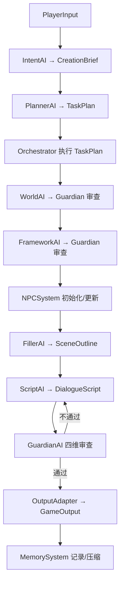

# MADNE - Multi-Agent Dynamic Narrative Engine

基于规格文稿构建的**初步框架**：输入玩家的一句话需求，由多个专业化 LLM Agent 协作，最终输出游戏引擎可消费的结构化叙事 JSON。

当前版本优先打通「数据契约 → 工作流 → Mock 全流程 → 审查回灌 → 持久化」，真实 LLM 与高级能力均保留清晰扩展点。

## 快速开始

```powershell
# 安装（开发模式）
python -m pip install -e ".[dev]"

# Mock 跑通完整流程（单回合）
python -m madne run --input "我想要一个赛博朋克世界里，关于记忆买卖的侦探故事"

# 连续 3 回合，并每 2 个记忆事件压缩一次，便于观察记忆回路
python -m madne run --input "我想要一个赛博朋克世界里，关于记忆买卖的侦探故事" `
  --turns 3 --compress-every 2 --print-json

# 断点续跑（模拟中断后恢复最近一次 ContextStore）
python -m madne resume --session demo

# 测试
python -m pytest
```

> 已 `pip install -e .` 后也可直接使用 `madne run ...`。

## 接入 DeepSeek

`madne.config` 会自动加载项目根目录或当前工作目录的 `.env`（已被 `.gitignore` 排除），真实环境变量优先。

复制 `.env.example` 为 `.env`，填入 Key：

```dotenv
LLM_API_KEY=sk-your-deepseek-key
LLM_BASE_URL=https://api.deepseek.com/v1
LLM_MODEL=deepseek-chat
MADNE_MOCK=0
```

然后直接运行（无需额外参数，CLI 会遵循 `.env`）：

```powershell
python -m madne run -i "我想要一个赛博朋克世界里，关于记忆买卖的侦探故事"
# 或显式指定真实模型
python -m madne run --real -i "我想要一个赛博朋克世界里，关于记忆买卖的侦探故事"
```

- `LLMClient.complete(prompt, system, json_schema)` 是唯一 LLM 入口。
- `MockLLMClient` 按系统提示词中的 `# AGENT_ID` 返回预设 JSON。
- `OpenAICompatClient` 通过标准 Chat Completions 接口调用，无第三方 HTTP 依赖；DeepSeek 只需配置兼容 Base URL 与 `deepseek-chat`。
- 未设置 `MADNE_MOCK` 且没有 API Key 时自动回退 Mock，保证 Demo 可运行。

## 目录结构

```text
madne/
├── config.py                 # 环境变量配置
├── exceptions.py             # 统一异常
├── models/                   # M0.2 全系统数据契约（Pydantic v2）
│   ├── base.py
│   ├── input.py / brief.py / plan.py
│   ├── world.py / framework.py / scene.py / script.py
│   ├── npc.py / review.py / output.py / memory.py
│   └── __init__.py           # 模型导出 + 持久化类型注册表
├── llm/                      # M0.1 LLM 抽象与实现
│   ├── base.py               # Protocol / JSON 提取 / AGENT_ID 解析
│   ├── mock.py               # 预设响应 + 脚本化响应队列
│   ├── fixtures.py           # 赛博朋克 Demo 全套 Mock 数据
│   └── openai_compat.py      # OpenAI 兼容客户端
├── agents/                   # M1/M2/M4-M8 Agent 模块
│   ├── base.py               # 统一 JSON 校验与纠错重试
│   ├── prompts.py            # 世界红线注入 / 审查反馈格式化
│   ├── intent.py / planner.py / world.py / framework.py
│   ├── filler.py / script.py / guardian.py
│   └── __init__.py
├── engine/                   # M3 规则驱动工作流引擎
│   ├── templates.py          # cold_start / continuation 静态模板
│   ├── context_store.py      # 共享上下文 + 断点持久化
│   ├── run_log.py            # JSONL 运行日志
│   └── orchestrator.py       # 调度 / 审查点 / 回退 / 续跑
├── npc/system.py             # M9 角色池 + 规则驱动的 traits 演变
├── memory/system.py          # M10 完整记忆 + 压缩记忆合并
├── output/adapter.py         # M11 GameOutput 打包与校验
└── cli.py                    # Typer Demo 入口
tests/
├── test_models.py
├── test_pipeline.py
└── test_engine_resilience.py
```

## 一次生成循环



- 每个步骤的成功/失败/重试/降级都写入 `runtime/sessions/<id>/runlog.jsonl`。
- 每完成一步把 `ContextStore` 落盘；`resume` 会跳过已完成步骤继续执行。
- Guardian 驳回时，`suggested_fix + issues` 回灌给生成模块重写，最多 2 次，仍失败则降级交付并告警。
- 世界红线会注入 Framework / Filler / Script / Guardian 的系统提示词。
- 续写时 Planner 选择 `continuation` 模板，并继承上一轮 WorldBible、NPC 池与框架。

## 产物位置

```text
runtime/sessions/<session_id>/
├── runlog.jsonl                 # 全流程 RunLog
├── npcs.json                    # NPC 档案与 traits
├── memory/
│   ├── full.jsonl               # 完整记忆事件流
│   ├── compressed.json          # 压缩记忆
│   └── meta.json                # 压缩触发计数
└── cycles/cycle_001/
    ├── context.json             # 可恢复上下文
    └── output.json              # 游戏引擎 JSON
```

## 当前实现范围

已实现（可运行、可测试）：

- M0 数据模型、LLMClient 抽象、Mock / OpenAI 兼容双实现
- M1–M7 Agent 主链路与提示词骨架
- M3 Orchestrator：模板调度、审查点、回退、RunLog、ContextStore 断点续跑
- M8 GuardianAI：世界观、框架、场景/台本三处审查；四维场景审查汇总；重写闭环
- M9 NPCSystem：角色池持久化、事件规则表驱动 traits 演变
- M10 MemorySystem：JSONL 完整记忆、每 N 事件压缩、压缩结果合并去重
- M11 OutputAdapter：GameOutput 打包与引擎字段校验
- CLI Demo：多回合模拟玩家选择、记忆压缩频率可配、断点恢复

后续扩展点（按规格继续迭代）：

- 并行执行无依赖步骤（World 与 NPC 池初始化等）
- NPC 复杂事件的 LLM 权重判定（当前为规则表 + 预留接口）
- SQLite 版完整记忆与更强的一致性事务
- 基于玩家真实选择推进 Beat（当前 Mock 框架固定，真实 LLM 会根据 `previous_framework` 推进）
- 流式输出、Token 精确计量、Guardian 审查缓存

## 测试覆盖

`python -m pytest` 覆盖：

- 数据模型校验（traits 截断、分支数量、GameOutput 引擎字段）
- Mock 全流程产出合法 `GameOutput`（含 3 个选项）
- Guardian 驳回后回灌重写闭环
- NPC traits 规则演变
- 压缩记忆合并去重
- ContextStore 模型往返持久化
- 多回合续写与压缩记忆注入
